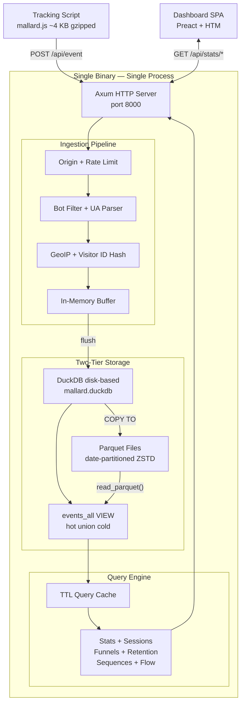

# Mallard Metrics

> **Self-hosted, cookieless web analytics in one Rust process, with an embedded DuckDB database and dashboard.**

[](DEVELOPMENT.md#current-metrics)
[](https://www.rust-lang.org)
[](LICENSE)
[](DEVELOPMENT.md#current-metrics)
[](#privacy-by-design)
[](https://tomtom215.github.io/mallardmetrics)

Mallard Metrics is a web-analytics server in the same family as Plausible and
Umami: you add a small script to your pages, events are stored on your own
machine, and a dashboard shows traffic, sources, goals, revenue and (with the
`behavioral` DuckDB extension) funnels, retention, sessions, sequences and flow.
It sets no cookies and never writes a visitor IP address to storage. See
[PRIVACY.md](PRIVACY.md) for exactly what is processed and what the operator
still owes under data-protection law.

## What it is, and what it is not

**Is:** one process that ingests, stores, queries, authenticates and serves the
dashboard. Storage is a DuckDB hot table plus date-partitioned Parquet files in
one data directory. The Docker image is a glibc build on distroless
(`gcr.io/distroless/cc-debian12`) running as UID 65532.

**Is not (today):**

- **Not dependency-free.** DuckDB is compiled in, but funnels, retention,
  sessions, sequences, flow and entry/exit pages come from the `behavioral`
  community extension, which is **downloaded from the DuckDB community
  repository on first start**. Without a route to it those endpoints answer
  `503`; everything else works. See [air-gapped hosts](#behavioral-extension-on-an-air-gapped-host).
- **Not multi-user.** There is one admin credential plus API keys with two
  scopes (`ReadOnly`, `Admin`). No teams, roles, per-site access or SSO.
- **Not multi-node.** One process, one data directory. No clustering or
  replication.
- **No published capacity figures.** [PERF.md](PERF.md) records micro-benchmarks
  only; it does not say how many events per second or how large a data set one
  host handles. Do not size a deployment from this project's marketing.
- **Not a full product suite.** There is no data import, scheduled report or
  alert, shareable public link, site-management UI or Search Console
  integration. [ROADMAP.md](ROADMAP.md) lists what is missing and why.

Funnels, journeys and retention are not part of Plausible Community Edition
according to its documentation, which is the main reason to pick Mallard over
it. Other open-source tools (Umami, Rybbit, OpenPanel, HitKeep) list funnels
too; compare them on their own terms.

---

## Table of Contents

- [Features](#features)
- [Quick Start](#quick-start)
- [Tracking Script](#tracking-script)
- [Configuration](#configuration)
- [How metrics are defined](#how-metrics-are-defined)
- [API Reference](#api-reference)
- [Architecture](#architecture)
- [Dashboard](#dashboard)
- [Technology Stack](#technology-stack)
- [Development](#development)
- [Deployment](#deployment)
- [Documentation](#documentation)
- [License](#license)

---

## Features

### Privacy by Design

- **No cookies.** The visitor ID is an HMAC-SHA256 of site + IP + User-Agent
  under a rotating salt. The tracking script sets no cookies and writes nothing
  to browser storage; it reads one `localStorage` key, `mallard_ignore`, which a
  site owner can set to opt their own browser out.
- **No IP address is stored.** The IP is held in memory for the GeoIP lookup and
  the visitor-ID hash, then dropped. One deliberate exception, off the analytics
  path: authentication events log a *truncated* address (IPv4 `a.b.c.x`, IPv6
  first three groups) so an operator can investigate an attack on the dashboard.
- **Rotating salt.** IDs change when the salt rotates (every UTC day by default).
- **Per-site scoping.** The site ID is part of the hash input, so one person on
  two sites of the same instance is not correlatable.
- **Pseudonymous, not anonymous.** Stored IDs are hashes, which GDPR still
  treats as personal data (Recital 26). Country, region and city derived from
  the IP are stored unless you reduce `geoip_precision`.

> **Salt rotation has an analytical cost.** With the default daily rotation a
> visitor seen on two days carries two unrelated IDs. "Unique visitors" over a
> multi-day range therefore counts visitor-days, and weekly retention cohorts
> cannot work at all. Raise `visitor_salt_rotation_days` for cross-day analysis,
> and read the trade-off in [PRIVACY.md](PRIVACY.md#the-salt-rotation-trade-off).

### Analytics

- **Core metrics**: unique visitors, pageviews, events, sessions, bounce rate,
  visit duration, views per visit. Session figures need the `behavioral`
  extension; without it they are `null`, not `0`.
- **Realtime**: current visitors, top pages and sources, per-minute series.
- **Twenty breakdown dimensions**: pages, entry and exit pages, referrers,
  sources, five UTM parameters, countries, regions, cities, browsers and
  versions, OS and versions, device types, screen widths, event names.
- **Segment filters**: `filters=countries==DE;devices!=mobile` narrows every
  figure in a report, not only one breakdown.
- **Period comparison**: `compare=previous_period` or `year_over_year` on
  `/api/stats/main`.
- **Goals, custom properties and revenue**: conversion per custom event;
  revenue reported per currency and never summed across currencies.
- **Time series**: hourly or daily buckets, gap-filled.
- **Behavioral** (extension required): cumulative funnels with ordering modes,
  weekly retention cohorts, ordered sequence matching, forward/backward flow.
- **Export**: daily summaries or raw events (CSV or JSON, streamed), and a
  Parquet export of one site and date range for a warehouse. Visitor IDs are
  never exported.
- **Saved segments**: named filter sets per site, applied from the dashboard.

### Sharing, data in and out, and notifications

- **Share links**: a revocable, read-only public link to one site's dashboard,
  optionally limited to a saved segment and an expiry. The token travels in the
  URL fragment, only its hash is stored, and the link cannot reach exports,
  other sites or any admin route. A segment cuts events, so a viewer sees
  nothing outside it. Read the [threat model](docs/src/share-links.md) first:
  a viewer can still drill down to a single visitor within the segment.
- **Import**: `mallard-metrics import ga4-bigquery` loads a Google Analytics 4
  BigQuery event export while the server is stopped. Other products' exports are
  aggregates or lack a published schema; see [Importing data](docs/src/importing-data.md).
- **Online backup**: `POST /api/admin/backup` snapshots both storage tiers while
  serving. See [Backup and Restore](docs/src/backup-restore.md).
- **Webhook alerts and reports**: signed notifications for operational problems
  and for traffic that drops or spikes against the same hour of earlier weeks,
  plus daily or weekly summaries. One URL, https by default, internal addresses
  refused. See [Alerts and reports](docs/src/alerts-and-reports.md).
- **Optional tracker extras**: scroll depth, engagement time, 404 pages and form
  submits in a second script with its own size budget; the main tracker stays
  small. See [Tracker extras](docs/src/extras.md).
- **Datacenter filter** (opt-in, needs an ASN database): drops traffic from
  hosting providers like other bot traffic.

### GDPR mode

`MALLARD_GDPR_MODE=true` switches on a bundle of data-minimising flags, each of
which can also be set on its own:

| Setting | Standard | GDPR mode |
|---|---|---|
| Visitor ID | HMAC-SHA256 hash | unchanged; `suppress_visitor_id` (not part of the bundle) replaces it with a random UUID per request |
| Referrer | Full URL | Query string and fragment removed |
| Timestamps | Full precision | Rounded down to the hour |
| Browser / OS | Name + version | Name only |
| Viewport width and device type | Stored | Omitted |
| GeoIP | `city` | `country` at most |

Because timestamps are rounded, anything that orders events inside an hour is
meaningless; with `round_timestamps` on (which GDPR mode sets) the sessions,
funnel, sequences, flow and entry/exit-page endpoints answer `503`, and the
session fields of `/api/stats/main` are `null`. `DELETE /api/gdpr/erase`
removes a site's data for a date range. Details and the legal framing are in
[PRIVACY.md](PRIVACY.md).

### Operations

- **Auth**: Argon2id password (12 characters minimum, enforced at startup and at
  setup), HttpOnly `SameSite=Strict` session cookie, API keys stored as SHA-256
  hashes (`mm_` prefix). A password set through the dashboard is persisted to
  `data_dir/admin.json`, so a restart does not reopen first-run setup.
- **Abuse limits**: per-site and per-client-IP ingest rate limits, login lockout
  per client address, and bounded buffers, sessions and tracking maps.
- **Durability**: Parquet files are written to a temporary name and renamed;
  flushes are staged and recovered on startup; the final flush runs after the
  server has drained on shutdown. Reads never observe a flush, compaction or
  erasure part-way through.
- **Observability**: `GET /metrics` (Prometheus text), `/health`,
  `/health/ready`, `/health/detailed`. Alert rules and a Grafana dashboard live
  in [`deploy/monitoring/`](deploy/monitoring).
- **Resource bounds**: configurable DuckDB `memory_limit` and thread count;
  analytics queries wait at most 10 s for a slot and are interrupted after 20 s.

---

## Quick Start

### Docker

```bash
docker run -d \
  -p 127.0.0.1:8000:8000 \
  -v mallard-data:/data \
  -e MALLARD_SECRET="$(openssl rand -hex 32)" \
  -e MALLARD_ADMIN_PASSWORD='choose-a-password-of-12-or-more-characters' \
  ghcr.io/tomtom215/mallardmetrics
```

`MALLARD_SECRET` must be at least 16 characters or the server refuses to start.
Keep the value: changing it changes every visitor ID. (Release images are
published by the release workflow on a version tag; this README was not able to
confirm which tag the registry currently holds.)

### Docker Compose (build from source)

```bash
echo "MALLARD_SECRET=$(openssl rand -base64 48)" > .env
docker compose up -d --build
```

The first build compiles DuckDB and takes several minutes. The compose file
requires `MALLARD_SECRET` and binds the port to `127.0.0.1`. For an
internet-facing host use [`deploy/docker-compose.production.yml`](deploy/docker-compose.production.yml).

### From source

```bash
# Rust 1.98.0 is installed automatically via rust-toolchain.toml
cargo build --release
./target/release/mallard-metrics
```

Open `http://localhost:8000`. Until an admin password exists, analytics are
readable by anyone who can reach the port (a deliberate mode for a public
dashboard; the dashboard warns about it and offers a button to set a password).
Set `MALLARD_ADMIN_PASSWORD`, or use that button, before exposing an instance.

`mallard-metrics --help` lists the command-line options: an optional config-file
path, `--healthcheck`, `--install-extension`, `--version`.

---

## Tracking Script

```html
<script defer data-domain="yourdomain.com"
  src="https://your-mallard-instance.com/mallard.js"></script>
```

`/js/script.js` is an alias of `/mallard.js` for people migrating from
Plausible. The script also exposes `window.mallard()` for custom events:

```javascript
// Track a custom event
window.mallard('signup', {
  props: { plan: 'pro', source: 'landing-page' }
});

// Track revenue
window.mallard('purchase', {
  revenue: 49.99,
  currency: 'USD',
  props: { product: 'annual-plan' },
  callback: () => console.log('tracked')
});
```

| Option | Type | Description |
|---|---|---|
| `props` | Object | Custom properties; the JSON must fit in 4096 bytes |
| `revenue` | Number | Revenue amount |
| `currency` | String | Three-letter ISO 4217 code |
| `callback` | Function | Called after the event is sent (uses XHR instead of `sendBeacon`) |

Script attributes (`data-api`, `data-exclude`, `data-hash`, `data-outbound`,
`data-downloads`, `data-link-query`, `data-honor-dnt`, `data-include-local`) are
documented in the header comment of [`tracking/script.js`](tracking/script.js)
and in [docs/src/tracking-script.md](docs/src/tracking-script.md).

The script is about 4.0 KB gzipped (4,013 bytes at `gzip -9`; CI enforces a
4,096-byte budget), has no dependencies, sets no cookies, and is served
unminified so you can read what runs in your visitors' browsers.

---

## Configuration

Mallard reads an optional TOML file (first command-line argument) and
`MALLARD_*` environment variables; **environment variables win**. Unknown TOML
keys are a startup error. [`mallard-metrics.toml.example`](mallard-metrics.toml.example)
lists every setting with its default and its environment variable, and
[docs/src/configuration.md](docs/src/configuration.md) explains them. The ones
most deployments touch:

| Variable | Default | Description |
|---|---|---|
| `MALLARD_SECRET` | generated and saved to `data_dir/.secret` | HMAC key for visitor IDs; at least 16 characters. Set it explicitly in production |
| `MALLARD_ADMIN_PASSWORD` | none | Dashboard password; at least 12 characters, a short list of obvious values is refused. A password that fails the policy stops startup |
| `MALLARD_DATA_DIR` | `data` | DuckDB file, Parquet files, extension cache, secrets. Must not contain `*`, `?`, `[` or `]` |
| `MALLARD_HOST`, `MALLARD_PORT` | `0.0.0.0`, `8000` | Bind address |
| `MALLARD_SITE_IDS` | none | Comma-separated allowlist, checked against both `Origin` and the payload |
| `MALLARD_SECURE_COOKIES` | `false` | `Secure` flag on the session cookie; set it behind TLS |
| `MALLARD_DASHBOARD_ORIGIN` | none | Restricts dashboard CORS to this origin and turns on the Origin/Referer check for session-authenticated writes |
| `MALLARD_TRUST_PROXY_HEADERS` | `false` | Take the client address from `X-Forwarded-For` / `X-Real-IP` |
| `MALLARD_TRUSTED_PROXY_HOPS` | `1` | With the above: the client is entry N counted **from the right** of `X-Forwarded-For` (1 to 8). One proxy is 1; a CDN in front of nginx is 2 |
| `MALLARD_VISITOR_SALT_ROTATION_DAYS` | `1` | Salt lifetime; see the note under Privacy by Design |
| `MALLARD_RETENTION_DAYS` | `0` | Delete Parquet partitions older than N days (0 keeps everything) |
| `MALLARD_GDPR_MODE` | `false` | Data-minimising bundle; see [PRIVACY.md](PRIVACY.md) |
| `MALLARD_METRICS_TOKEN` | none | Bearer token required by `/metrics` |
| `MALLARD_RATE_LIMIT`, `MALLARD_RATE_LIMIT_PER_IP` | `0`, `0` | Ingest events per second per site / per client IP (0 = unlimited) |
| `MALLARD_DUCKDB_MEMORY_LIMIT`, `MALLARD_DUCKDB_THREADS` | DuckDB defaults | Cap query memory (e.g. `1GB`) and worker threads |
| `MALLARD_EXTENSION_DIR` | `data_dir/extensions` | Where the `behavioral` extension is installed; on the data volume so it persists under a read-only root filesystem |
| `MALLARD_SHUTDOWN_TIMEOUT` | `30` | Seconds to let in-flight requests drain before the final flush |

Startup refuses to run when: `MALLARD_SECRET` is shorter than 16 characters;
`MALLARD_ADMIN_PASSWORD` fails the password policy; `data_dir/.secret` exists
but cannot be read; `login_lockout_secs` is 0; or a setting is out of range.
It logs a warning (it does not stop) for risky combinations such as an empty
`site_ids` with no per-IP rate limit, or `max_login_attempts = 0`.

---

## How metrics are defined

These definitions are implemented in `src/query/sessions.rs` and
`src/api/stats.rs`; a figure here means the following, which may differ from
other tools.

- **Session**: a run of one visitor's events (of any kind) with no gap larger
  than `session_window_minutes` (30 by default). Custom events keep a session
  alive. Only sessions containing at least one pageview are *counted*.
- **Bounce**: a counted session whose only interaction is its pageview. A custom
  event ends the bounce; the extras script's background `Scroll Depth` and
  `Engagement` events do not.
- **Visit duration**: last event minus first event in the session.
- **Views per visit**: mean pageviews per counted session.
- **Entry / exit page**: pathname of the session's first / last pageview.
- **Filters select sessions; they do not cut them.** A session is kept when it
  contains an event matching every filter and is then measured whole. Plain
  counts (visitors, pageviews, events) count only the matching events.
- **Flow** looks at pageviews only, with consecutive repeats collapsed.
- **Periods**: `7d`, `30d`, `90d` are that many calendar days **including
  today** (so `7d` is seven daily buckets); `12mo` is twelve months ending
  today; `day` and `today` are today. A lone `start_date` or `end_date` is a
  `400`; both are inclusive and may span at most 366 days.
- **Retention** looks back `visitor_salt_rotation_days` before the report start
  to decide whether a visitor is new.
- **Unique visitors** are distinct visitor IDs, so they obey the salt-rotation
  note above.

---

## API Reference

Everything under `/api/stats/*`, `/api/sites`, `/api/keys` and `/api/gdpr/*`
requires a session cookie or an API key (`Authorization: Bearer mm_...` or
`X-API-Key: mm_...`) once an admin password exists. Key management and erasure
additionally need an `Admin` key or session, and are refused before setup.
Ingestion, auth, health, `/metrics` (unless a token is set), `robots.txt` and
`security.txt` need no credentials. Full parameter and response documentation:
[docs/src/api-reference/](docs/src/api-reference).

### Common query parameters

| Parameter | Default | Description |
|---|---|---|
| `site_id` | required | Analytics property identifier |
| `period` | `30d` | `day`, `today`, `7d`, `30d`, `90d`, `12mo` |
| `start_date`, `end_date` | none | `YYYY-MM-DD`, both inclusive, given together, at most 366 days |
| `limit` | `10` | Rows for list endpoints; above the endpoint's maximum is a `400` |
| `filters` | none | Segment, e.g. `browsers==Chrome;countries!=US` |

### Errors

Errors produced by Mallard's handlers are JSON with a stable `code` and a
human-readable `error`, for example
`{"code":"bad_request","error":"start_date and end_date must be given together"}`.
Codes: `bad_request`, `unauthorized`, `not_found`, `internal_error`,
`too_many_requests`, `behavioral_unavailable`, `query_timeout`. A query that
exceeds its deadline is `504`; a request over the concurrent-query limit is `429`
with `Retry-After: 1`. A malformed query string rejected by the web framework
(for example a missing `site_id`) currently returns a plain-text `400` without a
`code`.

### Endpoints

| Method | Endpoint | Notes |
|---|---|---|
| GET | `/health` | Liveness; body `ok` |
| GET | `/health/ready` | Readiness; queries DuckDB, `503` if not ready |
| GET | `/health/detailed` | JSON status; `503` with `"status":"degraded"` when Parquet files exist that the `events_all` view does not read |
| GET | `/metrics` | Prometheus text, `text/plain; version=0.0.4` |
| GET | `/robots.txt`, `/.well-known/security.txt` | |
| POST | `/api/auth/setup`, `/api/auth/login`, `/api/auth/logout` | First-run password, login, logout |
| GET | `/api/auth/status` | Authentication state |
| POST | `/api/event` | Ingest (permissive CORS, preflight cached 24 h, 64 KB body limit) |
| GET | `/api/event` | Pixel: same fields in the query string, always answers a 1x1 GIF |
| HEAD | `/api/event` | Answers like the GIF and records nothing |
| GET | `/api/sites` | Site IDs that have data |
| GET | `/api/stats/main` | Headline figures; `compare=previous_period` or `year_over_year` adds a `comparison` object |
| GET | `/api/stats/timeseries` | Gap-filled visitors and pageviews per bucket |
| GET | `/api/stats/realtime` | Takes `filters`, not a date range; window is `realtime_window_minutes` |
| GET | `/api/stats/revenue`, `/goals`, `/properties`, `/property-values` | Revenue per currency; goal conversion; custom properties |
| GET | `/api/stats/breakdown/{dim}` | `pages`, `entry-pages`*, `exit-pages`*, `referrers`, `sources`, `countries`, `regions`, `cities`, `browsers`, `browser-versions`, `os`, `os-versions`, `devices`, `screen-sizes`, `utm-sources`, `utm-mediums`, `utm-campaigns`, `utm-contents`, `utm-terms`, `events` |
| GET | `/api/stats/sessions`* | Sessions, average duration, pages per session, bounce rate |
| GET | `/api/stats/funnel`* | `steps` (2 to 32, `page:/path` or `event:name`), `window`, `modes` |
| GET | `/api/stats/retention`* | `weeks` (2 to 32) |
| GET | `/api/stats/sequences`* | `steps` (2 to 32) |
| GET | `/api/stats/flow`* | `page`, `direction`, `limit` (max 100) |
| GET | `/api/stats/export` | `format=csv\|json`, `kind=daily\|raw` |
| POST, GET, DELETE | `/api/keys`, `/api/keys/{hash}` | Create, list, revoke API keys (Admin) |
| DELETE | `/api/gdpr/erase` | `site_id`, `start_date`, `end_date` (Admin) |

\* needs the `behavioral` extension and exact timestamps: answers `503` when the
extension is not loaded or `round_timestamps` is on.

Funnels default to `strict_once` (one event fills one step) unless the caller
passes `strict_once` or `strict_increase`. Other modes may be combined:
`strict`, `strict_deduplication`, `strict_order`, `allow_reentry` (only together
with `strict_order`, else `400`), `timestamp_dedup`. `retention` returns
`identity_supports_cohorts` and, when false, a `caveat`. Erasure that cannot
remove every partition answers `500` with `"status":"partial"` and
`failed_dates`. Raw exports are capped at 1,000,000 rows (default 100,000) and
are built in memory.

---

## Architecture



The module map is kept in one place:
[docs/src/architecture.md](docs/src/architecture.md#module-map).

---

## Dashboard

A Preact + HTM single-page app embedded in the binary with `rust-embed`; there
is no build step and no Node.js requirement at runtime. The selected site,
range, comparison and filters live in the URL, so a view can be bookmarked.


It shows headline figures with period comparison, a visitors/pageviews chart,
grouped breakdown tabs (pages, sources, locations, technology) where clicking a
row filters everything to it, realtime activity, goals, revenue, and the
behavioral reports; it also exports CSV/JSON and manages API keys (the key is
shown once).

---

## Technology Stack

| Component | Technology | Version |
|---|---|---|
| Language | Rust | 1.98.0 (edition 2024) |
| Web framework | Axum | 0.8 |
| Database | DuckDB, embedded, disk-based | 1.5.6 (`duckdb` crate 1.10506.1) |
| Behavioral analytics | `behavioral` extension, loaded at runtime | 0.10.0 or newer required |
| Storage format | Parquet, ZSTD, date-partitioned | |
| Frontend | Preact + HTM | no build step |
| Password hashing | Argon2id | `argon2` 0.6 |
| GeoIP | MaxMind GeoLite2 / MMDB | `maxminddb` 0.32 |
| Container | glibc binary on distroless `cc-debian12` | UID 65532; no musl build |

---

## Development

Prerequisites: Rust 1.98.0 (installed by `rust-toolchain.toml`) and Git. Build
tooling, the validation suite, test counts and the CI inventory are in
[DEVELOPMENT.md](DEVELOPMENT.md); the workflow and standards are in
[CONTRIBUTING.md](CONTRIBUTING.md).

```bash
cargo build
MALLARD_REQUIRE_BEHAVIORAL=1 cargo test --all-targets
```

---

## Deployment

Production stack (Caddy for TLS, internal-only network, backups, monitoring):
[`deploy/`](deploy) and [docs/src/deploy-vps.md](docs/src/deploy-vps.md). Fly.io:
[docs/src/deploy-flyio.md](docs/src/deploy-flyio.md).

### Reverse proxy (nginx)

```nginx
server {
    listen 443 ssl;
    server_name analytics.example.com;

    ssl_certificate     /etc/ssl/certs/analytics.example.com.crt;
    ssl_certificate_key /etc/ssl/private/analytics.example.com.key;

    location / {
        proxy_pass http://127.0.0.1:8000;
        proxy_set_header Host              $host;
        proxy_set_header X-Forwarded-For   $proxy_add_x_forwarded_for;
        proxy_set_header X-Forwarded-Proto $scheme;
        proxy_set_header X-Real-IP         $remote_addr;
    }
}
```

Run Mallard with `MALLARD_TRUST_PROXY_HEADERS=true` and
`MALLARD_TRUSTED_PROXY_HOPS=1`. Mallard counts `X-Forwarded-For` entries from
the right, so the entry your own nginx appended is the one it trusts and
anything a client put further left is ignored. Set the hop count to the number
of proxies you operate (2 with a CDN in front of nginx); too high a value lets a
client choose its address.

### GeoIP (optional)

Download a MaxMind GeoLite2-City `.mmdb` (free account required) and set
`MALLARD_GEOIP_DB=/path/to/GeoLite2-City.mmdb`. Without it, country, region and
city are `NULL`. An empty `MALLARD_GEOIP_DB` counts as unset.

### Behavioral extension on an air-gapped host

The extension is downloaded on first run. A host without an outbound route (the
production compose file puts Mallard on an internal network on purpose) cannot
install it, and the behavioral endpoints answer `503`. Seed it once from
somewhere with a route, against the same data directory:

```bash
mallard-metrics --install-extension
```

It writes the extension under the data directory (default
`data/extensions`) and exits without creating a database; every later start
loads it from disk. A cached extension older than 0.10.0 makes startup refuse.
Docker form: [the VPS guide](docs/src/deploy-vps.md).

---

## Documentation

| Document | Description |
|---|---|
| [Documentation site](https://tomtom215.github.io/mallardmetrics) | API reference, architecture, deployment, security |
| [PRIVACY.md](PRIVACY.md) | Data processing, GDPR / ePrivacy / CCPA notes, operator obligations |
| [SECURITY.md](SECURITY.md) | Security model, threat model, vulnerability reporting |
| [CONTRIBUTING.md](CONTRIBUTING.md) | Setup, workflow, standards, PR checklist |
| [DEVELOPMENT.md](DEVELOPMENT.md) | Commands, measured test and CI counts |
| [CHANGELOG.md](CHANGELOG.md) | Version history (Keep a Changelog) |
| [ROADMAP.md](ROADMAP.md) | Status, known limitations, gaps |
| [PERF.md](PERF.md) | Benchmark method and the figures actually measured |
| [LESSONS.md](LESSONS.md) | Numbered engineering lessons |
| [mallard-metrics.toml.example](mallard-metrics.toml.example) | Every setting with defaults |

---

## License

AGPL-3.0, see [LICENSE](LICENSE). Mallard Metrics is free software: you can
redistribute it and/or modify it under the terms of the GNU Affero General
Public License as published by the Free Software Foundation, version 3.
