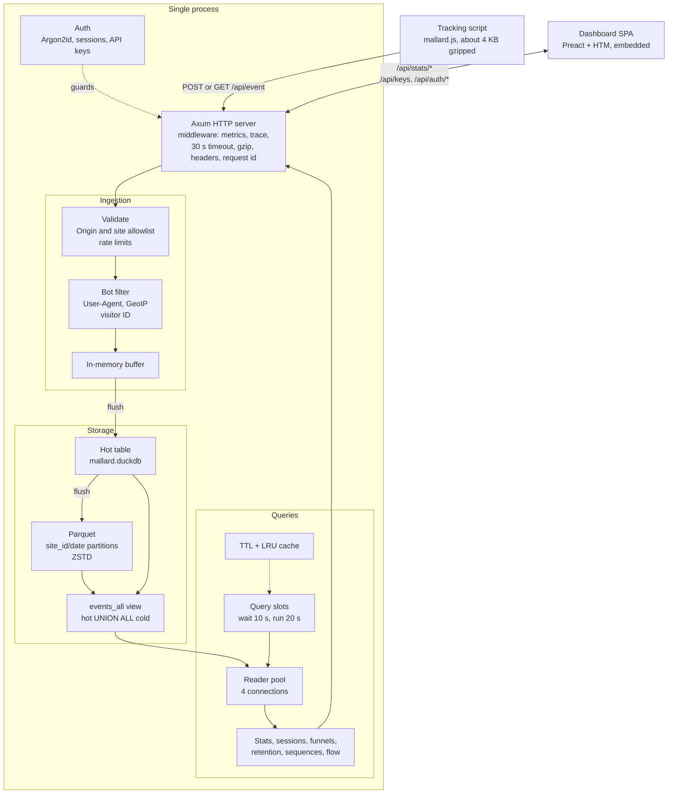
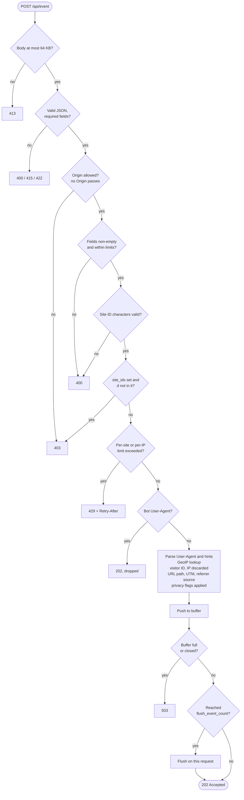
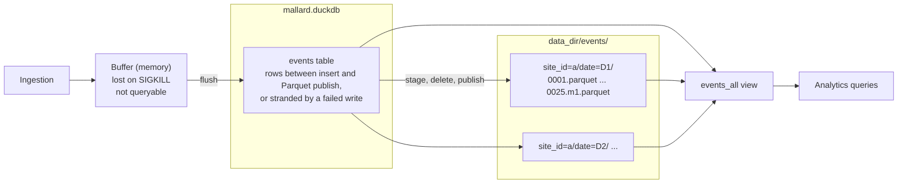
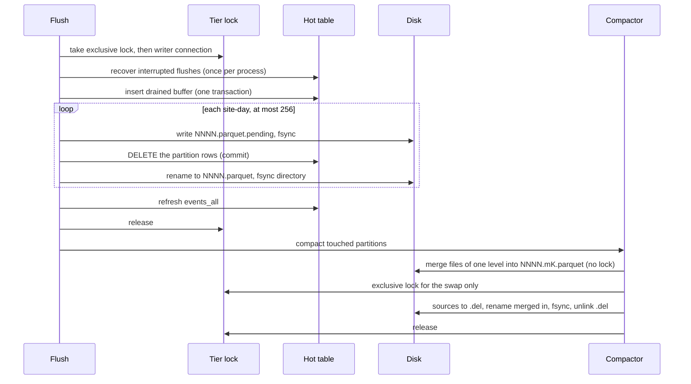
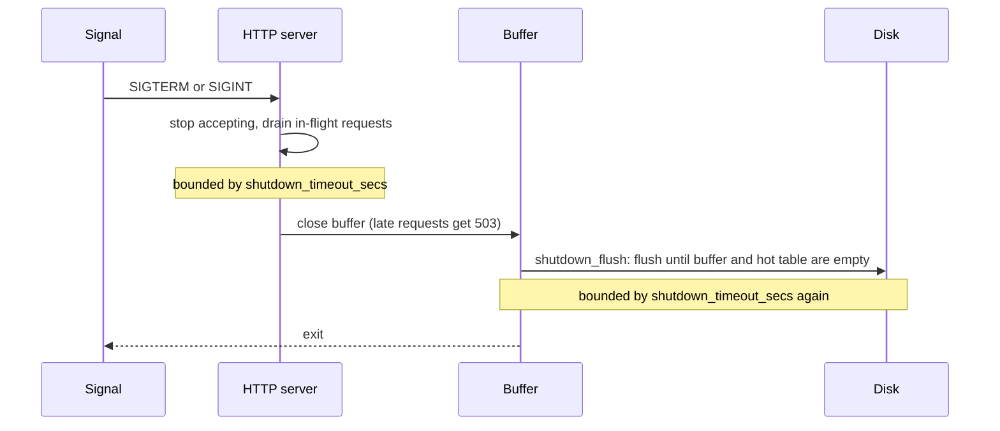
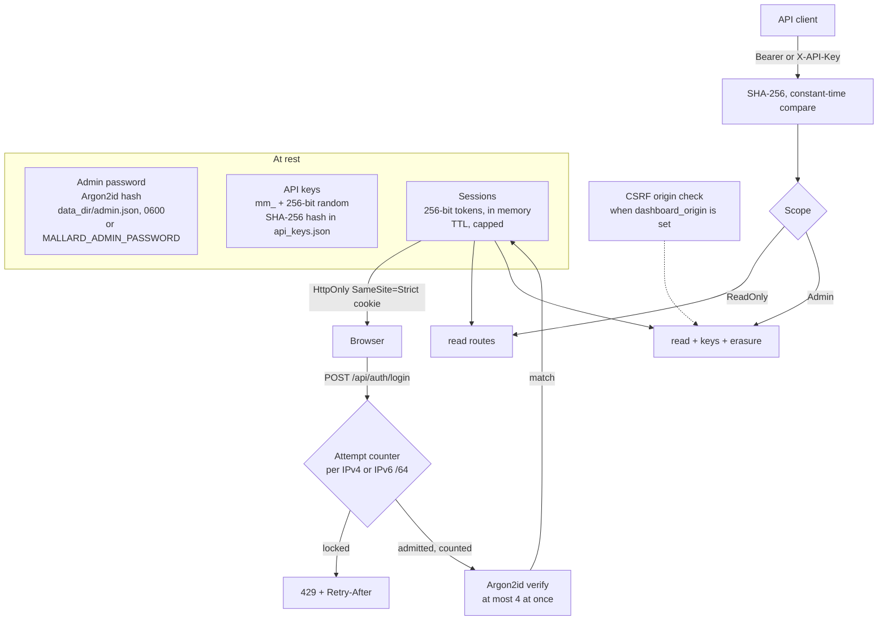
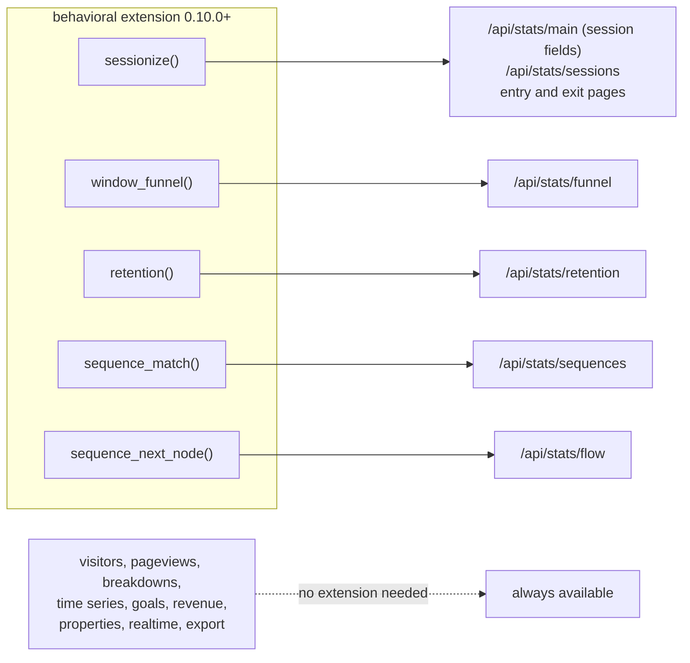

# Architecture

Mallard Metrics is one Rust binary: ingestion, storage, querying,
authentication and the dashboard in one process, with DuckDB embedded. No
message queue, no separate database. This page was checked against the source
(0.2.0 line).

## Overview

An accepted event lives first in the **in-memory buffer**, which is neither
durable nor queryable. A flush moves it into the hot table and on to Parquet in
one step. Everything else (hot table, Parquet) is durable; see
[Data Management](data-management.md).

## Request handling

Layers, outermost first (`src/server.rs`): HTTP metrics (so counters see the
status the client receives), tracing, the 30-second timeout (`408`), response
compression, security headers, `X-Request-ID`. Inside, `/api` has three groups:

| Group | Routes | Extra layers |
|---|---|---|
| Ingestion | `/api/event` (`POST`, `GET`, `HEAD`) | permissive CORS (24 h preflight cache), 64 KB body limit |
| Auth | `/api/auth/*` | none (CSRF check inside the handlers) |
| Protected | `/api/sites`, `/api/stats/*`, `/api/keys*`, `/api/gdpr/erase` | `require_auth` (reads), plus `require_admin_auth` for keys and erasure, dashboard CORS |

Outside `/api`: `/health*`, `/metrics`, `/mallard.js` and `/js/script.js` (the
tracker is compiled into the binary from `tracking/script.js`), `/robots.txt`,
`/.well-known/security.txt`, and the embedded dashboard for everything else.

## Event ingestion pipeline

## Three tiers and one view

`events_all` is `SELECT <columns> FROM events UNION ALL SELECT ... FROM
read_parquet('events/site_id=*/date=*/*.parquet', hive_partitioning)` with the
columns named explicitly so a new column cannot misalign against older files; the
directory keys give the planner partition pruning by site. The glob is
re-expanded on every query. On a fresh install, before any Parquet file exists,
the view is hot-only; it is rebuilt after a flush that writes the first file and
after retention or erasure removes partitions. `/health/detailed` reports the
`cold_tier` state.

## Flush, compaction and recovery

- **Crash points.** After the staged file is written: duplicate, dropped by
  recovery because its rows are still hot. After the `DELETE`: the staged file is
  the only copy and recovery publishes it. Decided by comparing row content
  (`EXCEPT ALL`), not by "does the partition have hot rows". After the merged
  file is published: leftover `.del` files are deleted. With a staging file plus
  `.del` files: the sources are restored.
- **Startup order** (`main.rs`): load and validate config; open DuckDB and apply
  settings; run migrations; load the behavioral extension; clean temporary files;
  recover pending flushes; build `events_all`; open the reader pool and load the
  extension on each reader; load the secret, admin hash and API keys; spawn the
  flush task (every `flush_interval_secs`), the retention task (if enabled; first
  run at startup, then daily) and the 15-minute housekeeping task; bind and serve.
  The port is not bound until the extension download attempt finished.

## Concurrency: tier lock, connections, reader pool

`TierLock` is a reader-writer lock around the windows in which hot table and
Parquet disagree (a flush between its `DELETE` and the rename, a compaction swap,
retention and erasure). Analytics queries hold the **shared** side only while they
execute; writers hold the exclusive side only for those windows. A query can
therefore never count a row twice or miss one. Compaction's expensive merge is
outside the lock.

`ReaderPool` holds `read_connections` (default 4) DuckDB connections cloned from
the writer, handed out round-robin. They share one buffer pool and catalog, so a
view refresh on the writer is seen by all of them, and so is `LOAD behavioral`
on the writer (a test pins this). Startup still loads it on each reader, which
is idempotent, and a background task retries every 60 s if the first install
failed, so `behavioral_extension_loaded` in `/health/detailed` can turn true
after boot. With `read_connections` 0 or 1 reads share
the writer connection and a slow query can block ingestion.

**Lock order.** Flush: tier lock, then connection. Readers take their
connection first, then *try* the tier lock; if a writer holds it they release the
connection, wait for the writer, and start over, so a reader never blocks on the
tier lock while holding a connection a flush needs.

**Query execution.** Every report passes a semaphore of
`max_concurrent_queries` slots. A request waits up to 10 s for a slot (`429`
after), and a watchdog interrupts the statement through DuckDB's interrupt handle
after 20 s (`504`), repeating the interrupt until the statement stops. Results
are cached by endpoint, site, range, parameters and parsed filters for
`cache_ttl_secs`; the cache is cleared for a site on erasure (an epoch check stops
an in-flight result from being cached after an erasure) and entirely after
retention removes data.

## Shutdown

Draining comes first on purpose: closing the buffer first would turn requests
that are still in flight into `503`s. Because each phase has its own bound, the
worst case is twice `shutdown_timeout_secs`. `SIGKILL` skips all of it.

## Authentication

Before an admin password exists, read routes are open and admin routes answer
`401`. See [Security](security.md).

## Behavioral extension

`INSTALL behavioral FROM community; LOAD behavioral;` runs at startup and the
version must be at least 0.10.0. If it cannot load, the server still starts and
the left-hand endpoints answer `503`; core analytics keep working. The same
endpoints are refused while timestamps are rounded to the hour. The extension is
published per DuckDB version and **only for glibc platforms**, which is why the
image is glibc and there is no musl build. See
[Behavioral Analytics](behavioral-analytics.md) and
[Troubleshooting](troubleshooting.md#behavioral-endpoints-answer-503).

## Module map

| Module | Purpose |
|---|---|
| `main.rs` | Startup order, background tasks, `--healthcheck`, `--install-extension`, signals, shutdown |
| `lib.rs` | Library root; the binary is a thin wrapper |
| `config.rs` | TOML and environment configuration, validation, advisories |
| `server.rs` | Router, middleware, CORS, security headers, `/metrics`, health probes |
| `test_support.rs` | `AppState` builder for tests |
| `ingest/handler.rs` | `POST/GET /api/event`; shared event construction; client-address resolution; `AppState` |
| `ingest/buffer.rs` | Bounded in-memory buffer, flush, `shutdown_flush`, compaction trigger |
| `ingest/visitor_id.rs` | Salt derivation and HMAC visitor ID |
| `ingest/useragent.rs` | User-Agent and Client Hints parsing, bot detection |
| `ingest/geoip.rs` | MaxMind reader |
| `ingest/ratelimit.rs` | Token-bucket limiters (site, IP) with bounded key tables |
| `storage/mod.rs` | `TierLock`, `ReaderPool` |
| `storage/schema.rs` | Table, `events_all` view, extension loading and version check, cold-tier status |
| `storage/parquet.rs` | Staged flush, recovery, compaction, retention, erasure |
| `storage/migrations.rs` | Schema versioning (refuses a newer database) |
| `query/mod.rs` | `QueryScope` (site, range, session window, filters) |
| `query/sessions.rs` | The one definition of a session (shared by metrics and entry/exit) |
| `query/metrics.rs` | Headline and session metrics |
| `query/breakdowns.rs` | Twenty dimensions, entry/exit pages |
| `query/timeseries.rs` | Gap-filled buckets |
| `query/realtime.rs` | Last-N-minutes snapshot |
| `query/funnel.rs`, `retention.rs`, `sequences.rs`, `flow.rs` | Behavioral reports |
| `query/events.rs`, `revenue.rs` | Goals, properties, revenue |
| `query/export.rs` | Daily and raw export (a chunked exporter exists but is not yet used by the handler) |
| `query/cache.rs` | TTL and LRU result cache with an erasure epoch |
| `api/stats.rs` | All analytics and erasure handlers, query execution (slots, deadline) |
| `api/errors.rs` | `ApiError`, status and `code` mapping |
| `api/auth.rs` | Sessions, API keys, admin password, CSRF, lockout, middleware |
| `api/share.rs` | Share links: token store, the gate that confines a share request, `/api/shared/` routes, admin endpoints, log redaction |
| `api/segments.rs` | Saved segments: store, validation by the filter parser, admin endpoints |
| `api/persist.rs` | `JsonList`, the atomic, owner-only JSON store behind share links and segments; OS-CSPRNG `random_hex` |
| `dashboard/` | Embedded SPA assets (`app.js`, `api.js`, `format.js`, `theme.js`, `style.css`) and the tracker route |
