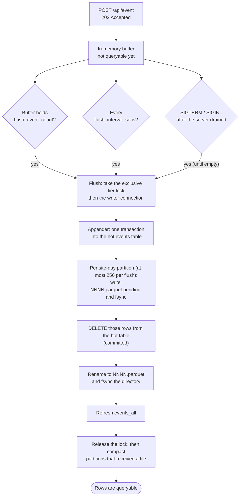

# Data Management

## Storage layout

Events live in two places and are always queried together (the `events_all`
view):

| Tier | Where | Holds |
|---|---|---|
| Buffer | process memory | Events accepted but not yet flushed. **Not queryable, and lost if the process is killed** (`SIGKILL`, power loss, OOM). |
| Hot table | `data_dir/mallard.duckdb` (table `events`) | Rows inserted by a flush that have not yet been moved to Parquet. Normally empty or tiny: a flush inserts and moves them in the same exclusive step. It holds rows when a Parquet write failed or a flush hit its per-flush partition cap; it is durable (WAL). |
| Cold tier | `data_dir/events/` (Parquet, ZSTD) | Everything else. |

```
data/
├── mallard.duckdb            hot table + catalog (and mallard.duckdb.wal while running)
├── events/
│   ├── site_id=example.com/
│   │   ├── date=2026-10-20/
│   │   │   ├── 0001.parquet        output of one flush
│   │   │   ├── 0002.parquet
│   │   │   └── 0025.m1.parquet     merge of 24 flush files (compaction level 1)
│   │   └── date=2026-10-21/
│   └── site_id=other.org/
├── extensions/               the behavioral extension (v1.5.6/linux_amd64/...)
├── exports/                  transient Parquet exports (empty unless one is in flight)
├── .secret                   visitor-ID secret, mode 0600 (only if MALLARD_SECRET is unset)
├── admin.json                Argon2id hash set through /api/auth/setup, mode 0600
└── api_keys.json             SHA-256 hashes of API keys
```

`.mN` in a file name is the compaction level. Files are plain Parquet and can be
read by any tool. Do not put `* ? [ ]` in the data directory's path: DuckDB would
read them as glob characters, so startup refuses such a path.

Leftovers you may see after a crash, all handled at startup:
`NNNN.parquet.pending` (a flushed file not yet published), `NNNN.parquet.del`
(a compaction source moved aside), `compact.parquet.tmp` (a merge in progress),
and, only if a staged file was unreadable and its rows were not in the hot
table, `NNNN.parquet.pending.corrupt`, which is left for you to inspect and is
never deleted automatically.

## Buffer and flush lifecycle



Order matters. A crash leaves one of two states, and startup recovery
(`recover_pending_flushes`) tells them apart by comparing the staged file with
the hot table row by row (`EXCEPT ALL`):

- every staged row is still in the hot table: the `DELETE` never committed, so
  the staged file is a duplicate and is dropped;
- some staged rows are no longer hot: the `DELETE` committed, the staged file is
  the only copy, and it is published.

While the tiers disagree (between the `DELETE` and the rename) queries are held
off by the tier lock, so a report never counts a row twice or misses it.

**Failure behaviour.** If the insert fails, the events go back to the front of
the buffer (nothing is lost). If the insert succeeds and the Parquet write
fails, the rows stay in the hot table, are still visible, and the next flush
retries even when no new event arrives. A failure after an event was accepted
does not fail the request that triggered the flush; it is counted in
`mallard_buffer_flush_failures_total` / `mallard_flush_failures_total` and
logged. If flushes keep failing, the buffer fills to `max_buffered_events` and
new events get `503` (`mallard_events_dropped_total`).

**Triggers.** Buffer size (`flush_event_count`, default 1000), a timer
(`flush_interval_secs`, default 60), and shutdown. **Visibility lag:** a new
event appears in reports after the next flush, up to `flush_interval_secs`
later (verified: three events posted with a 300 s interval returned zero events
from `/api/stats/main` until shutdown flushed them). `/health/detailed` shows the
pending count as `buffered_events`.

**Shutdown.** On `SIGTERM`/`SIGINT` the server first stops accepting
connections and drains in-flight requests (bounded by `shutdown_timeout_secs`),
then closes the buffer (late requests get `503`) and performs a final flush,
bounded by the same timeout again. Allow for both: the compose files use a 45 s
grace period. `SIGKILL` skips all of it and loses the buffer.

## Compaction

A 60-second interval writes about 1,440 files per site per day, and DuckDB reads
every file's footer on every query. After a flush, each partition that received
a file is checked: once it holds `compact_after_files` (default 24) files of one
level, they are merged into one file of the next level (`NNNN.mK.parquet`),
sorted by `timestamp`. Files only merge with files of their own level, so a large
merged file is not rewritten until enough large files exist.

The expensive part (reading and writing) runs **without** the tier lock; sources
are immutable. Only the swap takes it, and it is a few renames: move each source
to `.del`, rename the merged file in, fsync, unlink the sources. Any failure
undoes the earlier steps, and a crash is resolved at startup (staging file plus
`.del` files means "restore the sources"; `.del` files alone means "finished,
delete them"). One compaction runs at a time. `compact_after_files = 0` turns it
off.

## Data retention

`retention_days > 0` removes `date=YYYY-MM-DD/` directories older than the
threshold. The task runs at startup and every 24 hours. It takes the exclusive
tier lock, refreshes `events_all` (a view over a pattern that matches nothing
would fail every query), clears the query cache, and removes `site_id=*`
directories that no longer hold any partition. Hot-table rows are not affected
by retention; they leave when flushed and the resulting partition ages out.

`retention_days = 0` (default) keeps everything. Retention deletes whole days by
the **partition date**, so it cannot be used for per-visitor deletion.

## Erasure

`DELETE /api/gdpr/erase` removes a site's events for an inclusive date range from
both tiers. Semantics, partial failure and the limits of site-and-date
granularity are on [Privacy and GDPR](privacy-gdpr.md#erasure) and in the
[API reference](api-reference/stats.md#delete-apigdprerase).

## Importing and exporting

- [Importing Data](importing-data.md): `mallard-metrics import` loads a Google
  Analytics 4 BigQuery export (the one event-level export whose schema is
  documented) with the server stopped, and says why the other products' exports
  cannot be imported.
- [Exporting to Parquet](exporting-parquet.md): one site and date range as a
  single Parquet file for a warehouse, without `visitor_id`.

Imported rows are ordinary rows whose `visitor_id` starts with `imp:`.

## Backup and restore

Do not copy `mallard.duckdb` while the server runs: the database file and its
write-ahead log can be captured inconsistently, and such a copy often fails to
open. See [Backup and Restore](backup-restore.md) for what `deploy/backup.sh`
does and what each restore needs.

---

## Inspecting Data with DuckDB CLI

You can query Parquet files directly with the DuckDB CLI, independent of the Mallard Metrics server:

```bash
duckdb

-- Daily visitor and pageview counts for a site
SELECT
    CAST(timestamp AS DATE) AS date,
    COUNT(DISTINCT visitor_id)                            AS visitors,
    COUNT(*) FILTER (WHERE event_name = 'pageview')       AS pageviews
FROM read_parquet('data/events/site_id=example.com/**/*.parquet')
GROUP BY date
ORDER BY date DESC;

-- Top pages last 30 days
SELECT pathname, COUNT(*) AS views
FROM read_parquet('data/events/site_id=example.com/**/*.parquet')
WHERE event_name = 'pageview'
  AND CAST(timestamp AS DATE) >= CURRENT_DATE - INTERVAL 30 DAYS
GROUP BY pathname
ORDER BY views DESC
LIMIT 20;

-- Revenue by product
SELECT
    json_extract_string(props, '$.product') AS product,
    SUM(revenue_amount)                      AS total_revenue,
    COUNT(*)                                 AS transactions
FROM read_parquet('data/events/site_id=example.com/**/*.parquet')
WHERE event_name = 'purchase'
GROUP BY product
ORDER BY total_revenue DESC;
```

---

## Schema

The events table schema (also the Parquet file schema):

| Column | Type | Nullable | Description |
|---|---|---|---|
| `site_id` | VARCHAR | No | Site identifier |
| `visitor_id` | VARCHAR | No | HMAC-SHA256 privacy-safe visitor ID |
| `timestamp` | TIMESTAMP | No | UTC event timestamp |
| `event_name` | VARCHAR | No | Event type (e.g. `pageview`, `signup`) |
| `pathname` | VARCHAR | No | URL path |
| `hostname` | VARCHAR | Yes | The site ID again (ingest stores the validated `d` value, not the URL host) |
| `referrer` | VARCHAR | Yes | Referrer URL |
| `referrer_source` | VARCHAR | Yes | Parsed referrer source name |
| `utm_source` | VARCHAR | Yes | UTM source parameter |
| `utm_medium` | VARCHAR | Yes | UTM medium parameter |
| `utm_campaign` | VARCHAR | Yes | UTM campaign parameter |
| `utm_content` | VARCHAR | Yes | UTM content parameter |
| `utm_term` | VARCHAR | Yes | UTM term parameter |
| `browser` | VARCHAR | Yes | Browser name |
| `browser_version` | VARCHAR | Yes | Browser version string |
| `os` | VARCHAR | Yes | Operating system name |
| `os_version` | VARCHAR | Yes | OS version string |
| `device_type` | VARCHAR | Yes | `desktop`, `mobile`, or `tablet` |
| `screen_size` | VARCHAR | Yes | Viewport width in CSS pixels (e.g. `1920`) |
| `country_code` | VARCHAR(2) | Yes | ISO 3166-1 alpha-2 country code |
| `region` | VARCHAR | Yes | Region/state name |
| `city` | VARCHAR | Yes | City name |
| `props` | VARCHAR | Yes | Custom properties (JSON string, queryable via `json_extract`) |
| `revenue_amount` | DECIMAL(12,2) | Yes | Revenue amount |
| `revenue_currency` | VARCHAR(3) | Yes | ISO 4217 currency code |
