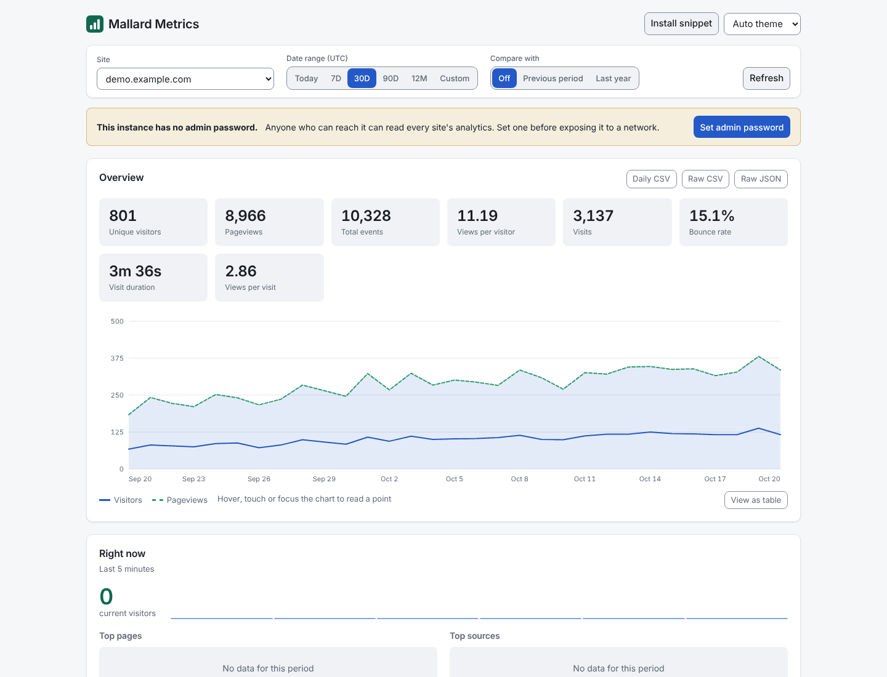

# Mallard Metrics

**Self-hosted, privacy-focused web analytics powered by DuckDB and the `behavioral` extension.**

Single binary. Single process. No separate database to run.

---

## What is Mallard Metrics?

Mallard Metrics is a lightweight, privacy-focused alternative to cloud analytics platforms. It runs on your infrastructure, sets no cookies, never stores IP addresses, and keeps only a rotating pseudonymous visitor ID. Whether a consent banner or a legal basis is needed in your jurisdiction is your decision: see [Privacy and GDPR](privacy-gdpr.md).

Built in Rust for predictable, low resource usage. The embedded DuckDB database — combined with the `behavioral` extension — provides SQL-native behavioral analytics: funnels, retention cohorts, session analysis, sequence matching, and flow analysis. No third-party services involved.

## Core Properties

| Property | Value |
|---|---|
| Language | Rust 1.98.0, edition 2024 |
| Web framework | Axum 0.8.x |
| Database | DuckDB 1.5.6 (disk-based, embedded, in-process; `duckdb` crate 1.10506.1) |
| Analytics | `behavioral` extension 0.10.0+ (installed and loaded at runtime) |
| Storage | DuckDB hot table plus date-partitioned Parquet (ZSTD-compressed) |
| Frontend | Preact + HTM (no build step, embedded in binary) |
| Deployment | glibc binary; distroless `cc-debian12` image (UID 65532), `linux/amd64` and `linux/arm64`. No musl build: the `behavioral` extension is not published for musl |

## Key Features

### Privacy by Design

- **No cookies** — Visitor identification is an HMAC-SHA256 of `site_id + IP + User-Agent` under a rotating salt (daily by default). See [Behavioral Analytics](behavioral-analytics.md#a-prerequisite-that-is-easy-to-miss-visitor-identity) for what that costs analytically.
- **No IP storage** — IP addresses are hashed and discarded; they are never written to the database, Parquet files or the application log.
- **Rotating salt** — Visitor IDs change every UTC day by default, preventing long-term tracking. `visitor_salt_rotation_days` lengthens the period where cross-day analysis matters more than the shorter pseudonym.
- **Pseudonymous, not anonymous** — the IDs are personal data under GDPR Recital 26. See [Privacy and GDPR](privacy-gdpr.md) and [Security](security.md).

### Single Binary Deployment

- One process handles ingestion, storage, querying, authentication, and the dashboard.
- DuckDB is embedded — no separate database to install or operate.
- Distroless Docker image: the binary and nothing else, no shell.
- Crash-safe storage: flushes are staged, fsynced and recovered at startup. Events still in the in-memory buffer (at most one flush interval) are lost if the process is killed; a graceful stop flushes them.

### Analytical Power

| Category | Capabilities |
|---|---|
| Core metrics | Unique visitors, pageviews, events, visits, bounce rate, visit duration ([definitions](metric-definitions.md)) |
| Breakdowns | Twenty dimensions — every column the ingest path populates |
| Segment filters | Narrow any report to `browsers==Chrome;countries!=US` |
| Time-series | Gap-filled hourly and daily aggregations |
| Realtime | Current visitors, top pages and sources, per-minute series |
| Goals and properties | Conversion rates per custom event, and their properties |
| Revenue | Totals per currency, event and page |
| Funnel analysis | Cumulative conversion funnels via `window_funnel()` |
| Retention cohorts | Per-visitor weekly cohorts via `retention()` |
| Session analytics | Duration, depth, bounce rate via `sessionize()` |
| Sequence matching | Behavioral patterns via `sequence_match()` |
| Flow analysis | Forward and backward navigation via `sequence_next_node()` |
| Export | Daily rollups or raw events, as CSV or JSON |

### Production Ready

- **Argon2id authentication** — Password-protected dashboard with cryptographic session tokens, and a credential that survives a restart.
- **API key management** — Programmatic access with SHA-256 hashed keys (`mm_` prefix), disk-persisted.
- **Rate limiting** — Per-site and per-IP token-bucket limiters on ingestion.
- **Query caching, concurrency cap and deadlines** — TTL cache, a bounded number of concurrent queries, and a 20-second query deadline.
- **Bot filtering** — Automatic filtering of known bot User-Agents.
- **GeoIP** — MaxMind GeoLite2 integration with graceful fallback.
- **Data retention** — Configurable automatic cleanup of old Parquet partitions.
- **Graceful shutdown** — Buffered events are flushed before process exit.
- **Prometheus metrics** — `GET /metrics` with ingestion, flush, auth, cache, rate-limit and HTTP latency series, plus ready-made alert rules and a Grafana dashboard.
- **OWASP security headers** — Including HSTS, CSP, Permissions-Policy, and X-Request-ID.
- **CSRF protection** — Origin/Referer validation on login, setup, logout and session-authenticated admin routes when `dashboard_origin` is set.
- **Brute-force protection** — Per-IP login lockout with configurable threshold and lockout duration.
- **GDPR-friendly mode** — A single `MALLARD_GDPR_MODE=true` toggle strips referrer queries, rounds timestamps to the hour, drops browser/OS versions and screen size and limits GeoIP to country. The cost: session-based reports are unavailable. An erasure endpoint (by site and date range) is always available. See [Privacy and GDPR](privacy-gdpr.md).

## When Should You Use Mallard Metrics?

Mallard Metrics is a good fit when you:

- Want full control over your analytics data on your own server.
- Want to keep visitor data out of third-party processors' hands.
- Are running a small-to-medium website and want low operational overhead.
- Need advanced behavioral analytics (funnels, retention, sequences) without a SaaS subscription.
- Want to see what DuckDB's `behavioral` extension can do on real traffic.

It is **not** designed for:

- Multi-region distributed analytics at very high volume (millions of events/minute).
- Real-time dashboards with sub-second latency: events appear after the next flush (up to 60 seconds by default).
- Replacing a full data warehouse.

## Project Status

Mallard Metrics is actively developed. Upgrading from 0.2.0? Read [Upgrading](upgrading.md) first. See [GitHub](https://github.com/tomtom215/mallardmetrics) for the latest releases and issue tracker.

The `behavioral` extension powering advanced analytics is developed at [github.com/tomtom215/duckdb-behavioral](https://github.com/tomtom215/duckdb-behavioral).

## Where to go next

- New here: [Quick Start](getting-started.md), then the [Tracking Script](tracking-script.md).
- Running it: [Deployment](deployment.md), [Monitoring](monitoring.md), [Backup and Restore](backup-restore.md), [Troubleshooting](troubleshooting.md).
- Understanding the numbers: [Metric Definitions](metric-definitions.md).
