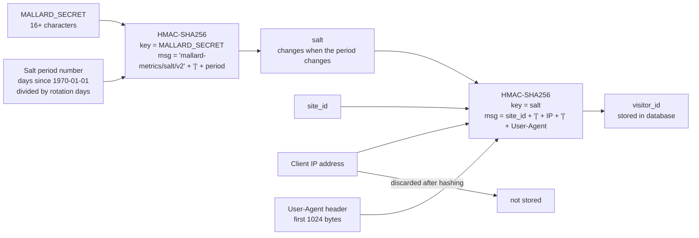

# Security & Privacy

## Privacy Model

Mallard Metrics is built with privacy as a hard constraint, not an afterthought.

### No Cookies

The tracking script sets no cookies. There is no cookie-based session tracking of any kind.

### No PII Storage

The client IP address is the only potentially identifying value that reaches the server. It is:

1. Used to compute the visitor ID (see below).
2. Used for a GeoIP lookup (if configured).
3. Used as an in-memory key for the rate limiters and the login lockout (an IPv6 address is reduced to its /64).
4. **Discarded.** It is never written to the database, Parquet files or the application log. (Login and lockout log lines carry an anonymised prefix only.)

The bundled Caddy configuration also logs no IP address, header or query string; see [Privacy and GDPR](privacy-gdpr.md#what-the-bundled-caddy-logs).

No names, email addresses, or device fingerprints are collected or stored.

### Privacy-Safe Visitor ID

To count unique visitors without storing PII, Mallard Metrics uses a two-step HMAC-SHA256 derivation:



Properties of this approach:

- **Deterministic within a salt period** — the same address and User-Agent on the same site give the same ID, so unique visitors can be counted. The period is one UTC day by default and is aligned to the Unix epoch (`visitor_salt_rotation_days`).
- **Unlinkable across periods** — once the period changes the same person has an unrelated ID.
- **Scoped per site** — the site ID is part of the input, so one person on two sites of one instance has two unrelated IDs.
- **Not reversible without the secret** — IPv4 space is small enough to enumerate, so the secret is what protects the stored hash. Keep it out of backups' reach and never log it.
- **No IP storage** — the address is discarded after hashing.

Consequences of rotation and of changing the secret are in [Privacy and GDPR](privacy-gdpr.md#salt-rotation).

### GDPR/CCPA Compliance

Mallard Metrics stores pseudonymous visitor IDs (HMAC-SHA256 hashes under a rotating salt, scoped per site), which are personal data under GDPR Recital 26. Operators must establish a lawful basis for processing — typically Art. 6(1)(f) legitimate interests for aggregate analytics, especially when combined with [GDPR mode](privacy-gdpr.md#gdpr-mode). See [PRIVACY.md](https://github.com/tomtom215/mallardmetrics/blob/main/PRIVACY.md) for the full legal analysis, DPIA guidance, and operator obligations.

Key points:
- **No cookies are set** for tracking — no ePrivacy consent banner is needed for the tracking script itself.
- **Erasure** is supported by site and date range via `DELETE /api/gdpr/erase` (admin only); see [Privacy and GDPR](privacy-gdpr.md#erasure).
- **No third-party data sharing** — all processing is first-party, no data processor agreements needed.

---

## Authentication Security

### Dashboard Password

Passwords are hashed with **Argon2id** using PHC default parameters before any comparison. The plaintext password is never stored.

The hash comes from `MALLARD_ADMIN_PASSWORD` when that variable is set. Otherwise it is read from `data_dir/admin.json`, where a password set through `POST /api/auth/setup` is written at mode 0600. That file is what makes the credential survive a restart: the hash previously lived only in memory, so a restart returned the instance to first-run mode and the next request to reach it — from anyone, not necessarily the operator — could set a new admin password and mint an admin API key that outlived the takeover.

`MALLARD_ADMIN_PASSWORD` is deliberately not written back to disk. The environment already supplies it on every start, and persisting it would leave a working credential behind after the variable was removed.

### Session Tokens

Dashboard sessions use **256-bit cryptographically random tokens** generated with the OS CSPRNG. Tokens are delivered as `HttpOnly; SameSite=Strict` cookies to prevent JavaScript access and CSRF.

The token is only in the cookie, never in a response body. Sessions are stored in memory with TTL expiry (default 24 hours, `session_ttl_secs`, at most `max_sessions`) and are cleared on restart.

The `Secure` flag is added when `MALLARD_SECURE_COOKIES=true` or `dashboard_origin` starts with `https://`. Set it whenever TLS is terminated in front of Mallard: without it the cookie is also sent over plain HTTP.

Password policy (setup endpoint and `MALLARD_ADMIN_PASSWORD` alike): at least 12 characters and not on a short list of obvious values. Setup attempts share the login attempt counter, so the open window before first setup cannot be brute-forced open.

### API Keys

| Property | Value |
|---|---|
| Entropy | 256 bits of randomness |
| Prefix | `mm_` — easy to identify in logs and secret scanners |
| Storage | SHA-256 hash stored in a JSON file in `data_dir/`. Plaintext returned only at creation. |
| Comparison | Constant-time equality to prevent timing side-channel attacks |
| Scopes | `ReadOnly` (read routes) or `Admin` (also key management and erasure) |
| Persistence | Disk-persisted; survive server restarts |

### Share Links

A share link is a revocable, read-only, no-login view of one site. The token is
256 bits from the OS CSPRNG, shown once, and stored only as a SHA-256 hash in
`data_dir/share_links.json` (mode 0600, atomic writes). It travels in the URL
fragment and an `X-Share-Token` header, so it is in no URL the server sees, no
log and no `Referer`. It is **not** an API key: it opens only the read-only
`/api/shared/` routes, with `site_id` forced to the link's site, the link's
segment added to every query, and no exports. Expiry and revocation apply on the
next request. The full design, threat model and the list of what is *not*
protected is in [Share Links and Segments](share-links.md).

---

## Input Validation and SQL Injection Prevention

### Parameterized Queries

Filter values, site IDs and dates are bound as parameters of DuckDB prepared statements. Interpolation is used only where DuckDB cannot bind (file paths, the session window and a funnel window), and those values come from validated configuration or a strict pattern, never raw request text. A column name always comes from an enum, never from the request.

### Path Traversal Prevention

A site ID is limited to 1-256 characters from `[a-zA-Z0-9._\-:]` at the API boundary, which already excludes separators and null bytes. The storage layer applies a second check before any filesystem use and refuses an empty value, `.`, `..`, any `..` substring, a leading dot, `/`, `\\` and control characters.

### Funnel and Sequence Step Validation

User-supplied funnel and sequence steps (from `?steps=` query parameters) are parsed from a safe `page:/path` or `event:name` format. Raw SQL expressions are never accepted from the API. Single quotes in path values are escaped by doubling.

### Date Range Validation

`start_date` and `end_date` are validated as `YYYY-MM-DD`, must be given together, must satisfy `end >= start`, and may differ by at most 366 days.

### Breakdown Limit

The `limit` parameter for breakdown queries is capped at 1000 to prevent unbounded result sets.

### Origin Validation

When `site_ids` is configured, the `Origin` header (if present) is validated with **exact host matching**, and the payload's `d` field must be in the list as well, because a non-browser client sends no `Origin`:

- `https://example.com` → passes (if `"example.com"` is in `site_ids`).
- `http://example.com:8080` → passes (explicit port suffix allowed).
- `https://example.com.evil.com` → **rejected** (prefix match is explicitly disallowed).

### CSV Injection Prevention

The CSV export quotes every field and prefixes values beginning with `=`, `+`, `-`, `@`, tab or carriage return with a single quote, so a spreadsheet does not evaluate them.

---

## Brute-Force Protection

Login and setup attempts are counted per client address: the IPv4 address, or the IPv6 /64 (one subscriber owns a whole /64). An attempt is counted **when it is admitted**, before the slow password check, so a burst of parallel guesses and a client that hangs up mid-check cannot get free tries. After `max_login_attempts` consecutive failures (default 5) the address is locked out for `login_lockout_secs` (default 300) and receives `429` with `Retry-After` set to the remaining seconds. A success clears the count. State is in memory and resets on restart.

At most four Argon2 operations run at once; a request that cannot get a slot within 10 seconds gets `503` with `Retry-After: 1` and keeps its attempt.

The address is the one the deployment resolves: the peer socket by default, or entry `trusted_proxy_hops` from the **right** of `X-Forwarded-For` when `trust_proxy_headers` is on. A leftmost entry is client-supplied and is never believed. If `trust_proxy_headers` is off behind a proxy, every visitor shares the proxy's address and five wrong passwords from anyone lock the admin out.

Configure via TOML fields `max_login_attempts` and `login_lockout_secs`, or the environment variables `MALLARD_MAX_LOGIN_ATTEMPTS` and `MALLARD_LOGIN_LOCKOUT`. Set `max_login_attempts = 0` to disable.

---

## Security Headers

All HTTP responses include these OWASP-recommended security headers:

| Header | Value | Purpose |
|---|---|---|
| `X-Content-Type-Options` | `nosniff` | Prevents MIME-type sniffing |
| `X-Frame-Options` | `DENY` | Prevents clickjacking via iframe embedding |
| `Referrer-Policy` | `strict-origin-when-cross-origin`; `no-referrer` on every [share link](share-links.md) response | Limits referrer leakage |
| `Content-Security-Policy` | `default-src 'self'; script-src 'self'; style-src 'self'; img-src 'self' data:; connect-src 'self'; frame-ancestors 'none'; base-uri 'none'; form-action 'self'` (HTML responses only) | Restricts scripts and resources to same origin |
| `Permissions-Policy` | `geolocation=(), microphone=(), camera=(), interest-cohort=()` | Disables browser feature APIs |
| `Strict-Transport-Security` | `max-age=31536000; includeSubDomains; preload` | Instructs browsers to enforce HTTPS for 1 year; eligible for preload lists |
| `Cache-Control` | `no-store, no-cache, private` (`no-store` on every share link response) | JSON and CSV responses; prevents shared caches holding analytics data |
| `Retry-After` | `1` | Added to any `429` that lacks one |
| `X-Request-ID` | UUID per request | Injected by the server, propagated through tracing spans for log correlation |

---

## HTTP Timeout

All requests have a 30-second server-side timeout. Connections that do not complete within this window are closed with `408 Request Timeout`. This prevents Slowloris-style attacks that hold connections open indefinitely.

---

## CSRF Protection

When `dashboard_origin` is set, these are checked against it: login, setup and logout, and the session-authenticated admin routes (key creation, listing and revocation, erasure). `Origin` is compared first (scheme and host case-insensitively, default ports ignored); if it is absent, the `Referer`'s origin is used. A **mismatch is `403`**. A request with **neither header** (curl, a script) is allowed, and **API-key requests are not checked at all**: a key is not an ambient credential a browser sends by itself.

When `dashboard_origin` is not set the check is off. **Set it in production.**

---

## Network Security

### CORS Policy

Mallard Metrics uses separate CORS policies for ingestion and dashboard routes:

**Ingestion** (`/api/event`):
```
Access-Control-Allow-Origin: *
Access-Control-Allow-Methods: POST,GET
Access-Control-Allow-Headers: content-type
Access-Control-Max-Age: 86400
```

**Dashboard / Stats / Admin** (when `dashboard_origin` is set):
```
Access-Control-Allow-Origin: <configured origin>
Access-Control-Allow-Methods: GET, POST, DELETE
Access-Control-Allow-Credentials: true
```

If `dashboard_origin` is not configured, the dashboard routes answer `Access-Control-Allow-Origin: *` **without** `Allow-Credentials`, so a third-party page can call them but cannot send a logged-in visitor's cookie. Set `dashboard_origin` in production to restrict cross-origin access.

### TLS

Mallard Metrics does not handle TLS directly. In production, place it behind a TLS-terminating reverse proxy (nginx, Caddy, Traefik, etc.). Set `MALLARD_SECURE_COOKIES=true` once the proxy is in place.

### Request Concurrency

Every analytics endpoint runs under one semaphore of `MALLARD_MAX_CONCURRENT_QUERIES` slots (default 10). A request waits up to 10 seconds for a slot, then gets `429` with `Retry-After`; a statement running longer than 20 seconds is interrupted and answers `504`. The ingest path has its own rate limiters (`MALLARD_RATE_LIMIT`, `MALLARD_RATE_LIMIT_PER_IP`) and a 64 KB body limit.

---

## Supply Chain

- All Rust dependencies are audited with `cargo-deny` in CI (a pinned version, weekly and on lockfile changes; see `.github/workflows/security.yml`).
- GitHub Actions steps are pinned to exact commit SHAs (no floating version tags).
- The `bundled` DuckDB feature compiles DuckDB from source as part of the build; no pre-built DuckDB binaries are downloaded at runtime.
- `cargo build --locked` is used in CI to ensure reproducible builds from `Cargo.lock`.

---

## Threat Model Summary

| Threat | Mitigation |
|---|---|
| SQL injection | Parameterized queries throughout; `site_id` character validation |
| Path traversal | `is_safe_path_component()` on all filesystem paths |
| CSRF | Origin/Referer validation on state-mutating session-auth routes |
| Brute force (login) | Per-IP lockout, Argon2id hashing |
| Abuse of ingest | Per-site and per-IP token buckets, body limit, optional `site_ids` allowlist |
| Session hijacking | `HttpOnly; SameSite=Strict` cookies, plus `Secure` when configured |
| Timing attacks | Constant-time comparison for API keys |
| Clickjacking | `X-Frame-Options: DENY` |
| Protocol downgrade | `Strict-Transport-Security` (HSTS, 1 year) |
| MIME sniffing | `X-Content-Type-Options: nosniff` |
| Data exfiltration | The only outbound request is the one-time `behavioral` extension download; embedded DB; IP discarded after hashing |
| PII leakage | IPs hashed then discarded; per-period ID rotation; no cookies; no IP in the bundled Caddy log |
| CSV injection | Formula character escaping in export output |
| Leaked or guessed share link | 256-bit CSPRNG token, hash-only storage, revocation and expiry on the next request, per-link, global and per-client rate limits; a leaked link stays valid until revoked ([what is not protected](share-links.md#what-is-not-protected)) |
| Share link used beyond its site, segment or read-only scope | Own router outside the key and session layers; `site_id` forced (another site is `403`); segment AND-ed into every query; no export or admin route is mounted |
| Share token in logs, history or `Referer` | Carried in the URL fragment and a header, never in a URL the server sees; request-log redaction as a backstop; `no-referrer` and `no-store` on share responses |
| Dependency vulnerabilities | `cargo-deny` in CI; `Cargo.lock` committed and enforced |
